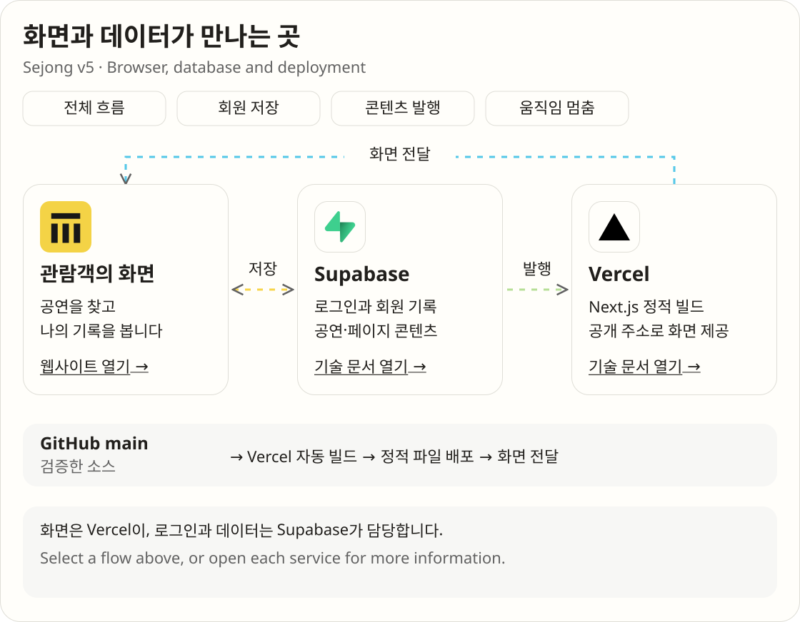
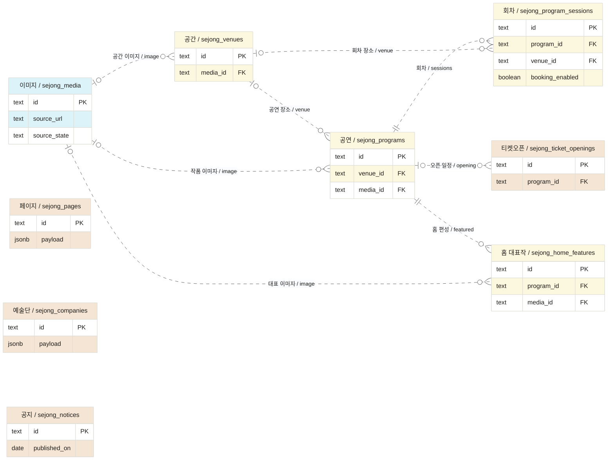
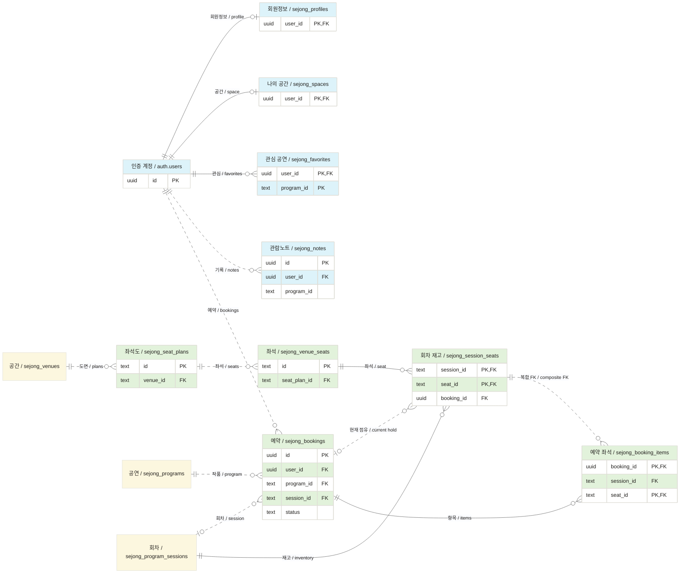
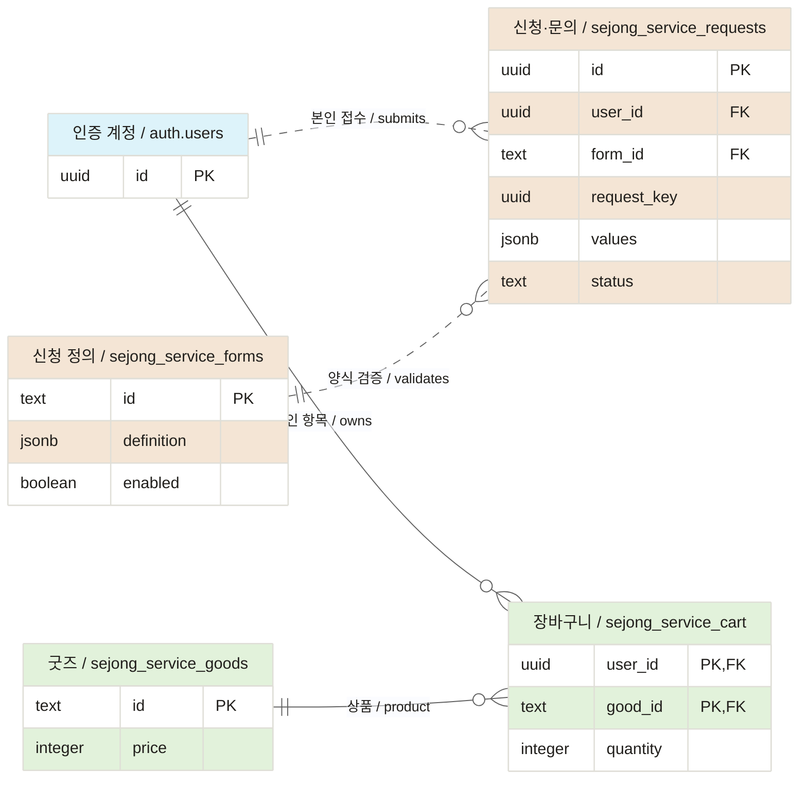

# 세종문화회관 리뉴얼 / Sejong Center Renewal

공연을 찾는 순간부터 관람 준비와 나의 기록까지 이어지는 웹사이트를 만들고 있습니다. 현재 개발 버전은 **v5**입니다. 이전 화면은 버전별 폴더에 보존합니다.

A website for discovering performances, planning a visit, and keeping a personal cultural record. **v5** is the active application; earlier versions remain in their own folders.

**[웹사이트 / Website](https://renewsejongpac.rhee.life/v5/)** · [디자인 시스템 / Design system](https://renewsejongpac.rhee.life/v5/design-rules/) · [기여 안내 / Contributing](CONTRIBUTING.md)

| v5 | Supabase | Vercel |
| :---: | :---: | :---: |
| [](https://renewsejongpac.rhee.life/v5/) | [](https://supabase.com/) | [](https://vercel.com/) |
| 화면과 인터랙션<br>Interface and interaction | 로그인과 데이터베이스<br>Authentication and database | 빌드와 웹 배포<br>Build and web hosting |

## 처음 보는 분께 / Start here

코드를 실행하지 않아도 공개 사이트에서 확인할 수 있습니다. 수업·발표에서는 다음 순서로 살펴보면 전체 구성이 보입니다.

The public website needs no local setup. For a class or presentation, follow these three paths.

| 순서 / Step | 해 볼 일 / Try it | 확인할 내용 / What to look for |
| --- | --- | --- |
| 1. 공연 찾기 / Discover | [홈](https://renewsejongpac.rhee.life/v5/)에서 히어로와 퀵메뉴를 조작하고 [프로그램](https://renewsejongpac.rhee.life/v5/programs/)을 검색합니다. | 하나의 대표 콘텐츠, 날짜·분류 필터, 공연 상세 / Featured content, filters and program details |
| 2. 나의 기록 / Keep a record | Google로 로그인한 뒤 관심 공연을 등록하고 [나의 공간](https://renewsejongpac.rhee.life/v5/account/)을 엽니다. | 계정에 저장되는 관심 공연·관람노트와 미니룸 / Account-backed favorites, notes and mini room |
| 3. 같은 규격 / Inspect the system | [디자인 시스템](https://renewsejongpac.rhee.life/v5/design-rules/)에서 버튼·입력·알림·유리 표면을 봅니다. | 제품과 가이드가 사용하는 같은 컴포넌트 / The same components used by the product and guide |

### 현재 가능한 일 / Current capabilities

공연·전시·교육 탐색, 공간·교통·대관 안내, 소식과 기관 정보, Google·이메일 링크 로그인, 회원 기록, 신청·문의와 굿즈 장바구니를 구현했습니다. 콘텐츠와 회원 데이터는 Supabase DB를 사용합니다.

Program discovery, visitor and rental information, news, sign-in, member records, service requests and a goods cart are implemented. Supabase holds the content and member data.

**좌석 예약 엔진과 실제 운영 예매는 구분합니다.** 서버의 좌석 보류·미결제 예약·취소 로직은 구현돼 있습니다. 확인된 좌석도·회차·가격에서만 예약을 열며, 2026-10-23 DB 조회 당시 등록 회차는 0개였습니다. PG 결제와 발권은 아직 연결하지 않았습니다.

The server supports seat holds, unpaid reservations and cancellation. Booking opens only for verified operational data; no sessions were registered at the 2026-10-23 schema check. Payment processing and ticket issuance are not connected.

## 어떻게 움직이나요 / How it works

[](https://renewsejongpac.rhee.life/docs/readme/system-overview.svg)

**그림을 누르면 조작 가능한 SVG가 열립니다.** `회원 저장`과 `콘텐츠 발행`을 선택하면 해당 흐름과 설명이 바뀝니다. 키보드로도 선택할 수 있으며 움직임 정지와 모션 감소 설정을 지원합니다. GitHub README 안에서는 이미지 미리보기로 표시됩니다.

Click the diagram to open the interactive SVG. Choose a flow with the pointer or keyboard, or pause its motion. The README itself shows an image preview. [SVG image-context restrictions](https://developer.mozilla.org/en-US/docs/Web/SVG/Guides/SVG_as_an_image)

| 구성 / Part | 쉬운 설명 / Plain explanation | 실제 역할 / Implementation |
| --- | --- | --- |
| Next.js · React · TypeScript | 화면을 만들고 사용자의 조작에 반응합니다. / Builds the interface and handles interaction. | `v5/app/`, `v5/components/` |
| Supabase Auth | 로그인한 사람이 누구인지 확인합니다. / Identifies the signed-in user. | Google OAuth, 이메일 로그인 링크 / Email sign-in links |
| Supabase PostgreSQL | 공연 정보와 회원 기록을 저장합니다. / Stores content and member records. | 공개 콘텐츠, 소유자별 RLS, 예약·신청 RPC / Catalog, owner RLS and server functions |
| Vercel | 검증한 코드를 빌드해 공개 주소로 전달합니다. / Builds and serves the site. | `main` 푸시 → 정적 빌드 → 배포 / Push, build, deploy |

브라우저는 공개 콘텐츠를 읽고, 로그인한 사용자는 자신의 데이터에 접근합니다. **RLS**는 DB에서 회원별 행 접근을 제한하는 규칙이고, **RPC**는 좌석 확보나 신청 검증처럼 서버에서 한 번에 처리해야 하는 함수를 호출하는 방법입니다.

Public content is readable without signing in. **RLS** controls access to each member's rows; **RPC** calls database functions for operations such as reserving seats or validating requests.

### DB가 있는데 파일도 있는 이유 / Why files still exist

| 자료 / Data | 원본 / Source of truth | 파일의 역할 / Role of files |
| --- | --- | --- |
| 공연·공간·페이지·공지 / Published content | Supabase DB | 빌드가 `src/generated/catalog-snapshot.json`을 생성합니다. 브라우저에서도 공개 카탈로그를 갱신합니다. / Generated build snapshot, refreshed in the browser. |
| 관심 공연·관람노트·신청 / Member records | Supabase DB | 인증과 조회·저장 코드를 둡니다. 브라우저 저장을 DB 저장으로 대신하지 않습니다. / Client integration, not a substitute for database persistence. |
| 색상·규격·컴포넌트 / Design contracts | TypeScript 소스 / Source code | 리뷰·버전 관리·자동 검사 대상으로 유지합니다. / Versioned definitions used by audits. |
| 초기 수입·마이그레이션 / Imports and migrations | SQL 및 편집 원본 / SQL and editorial sources | 재현 가능한 DB 변경·콘텐츠 수입 이력입니다. / Reproducible schema and content history. |

스냅샷과 빌드 결과는 직접 편집하지 않습니다. 공개 DB를 읽을 수 없으면 빌드는 실패하며, 목업 데이터로 조용히 대체하지 않습니다. [카탈로그 저장소](v5/src/catalog/repository.ts) · [빌드 스냅샷](v5/scripts/catalog/snapshot.ts)

Do not hand-edit generated snapshots or exports. A build fails if it cannot read the published database; it does not silently replace the catalog with mock content.

## 내 컴퓨터에서 실행 / Run locally

**Node.js 24.x**와 npm이 필요합니다. 다음은 Windows PowerShell 예제입니다. macOS·Linux에서는 `npm.cmd` 대신 `npm`, `npx.cmd` 대신 `npx`를 사용합니다.

Use **Node.js 24.x** and npm. The examples target Windows PowerShell; use `npm` and `npx` on macOS or Linux.

```powershell
git clone https://github.com/hslcrb/renewsejongpac.git
cd renewsejongpac/v5
npm.cmd ci
```

`v5/.env.local`을 만들고 자신의 Supabase 공개 설정을 넣습니다. 서비스 역할 키나 Google Client Secret을 넣는 파일이 아닙니다. 이 파일은 커밋하지 않습니다.

Create `v5/.env.local` with your Supabase public configuration. Do not commit it or put service-role keys or Google secrets in browser configuration.

```dotenv
NEXT_PUBLIC_SUPABASE_URL=https://YOUR_PROJECT_REF.supabase.co
NEXT_PUBLIC_SUPABASE_ANON_KEY=YOUR_PUBLIC_API_KEY
```

```powershell
npm.cmd run dev -- --hostname 127.0.0.1
```

[로컬 홈 / Local home](http://127.0.0.1:3000/v5/) · [로컬 디자인 시스템 / Local design system](http://127.0.0.1:3000/v5/design-rules/)

주소에 `/v5/`를 포함해야 합니다. 로그인은 Supabase의 제공자·복귀 URL 설정도 필요합니다. 상세 설정과 오류 해결은 [기여 안내](CONTRIBUTING.md#인증과-환경-설정--authentication-and-environment)를 참고하세요.

Include `/v5/` in the URL. Sign-in also requires provider and redirect configuration; see [Contributing](CONTRIBUTING.md#인증과-환경-설정--authentication-and-environment).

## 데이터 관계 / Database relationships

2026-10-23 운영 DB의 외래 키와 마이그레이션을 대조했습니다. **공개 테이블 22개**를 목적에 따라 세 그림으로 나눴습니다. `auth.users`는 Supabase 인증 테이블이며 22개에 포함하지 않습니다. 감사 이력은 비공개 스키마의 `sejong_private.content_revisions`에 따로 둡니다.

These three ERDs cover all **22 public tables**, checked against database foreign keys and migrations on 2026-10-23. `auth.users` and the private revision log are separate.

하늘색은 인증·회원, 노랑은 공연 콘텐츠, 초록은 재고·거래, 연한 황토색은 접수·소식입니다. `PK`는 기본 키, `FK`는 실제 외래 키, `0..N`은 여러 행이 연결될 수 있다는 뜻입니다. 세부 필드는 읽기 쉽게 발췌했습니다.

Sky: identity and members. Yellow: cultural content. Green: inventory and transactions. Ochre tint: requests and news. `PK` means primary key, `FK` means a physical foreign key; fields are abbreviated for readability.

### 1. 공연과 공개 콘텐츠 / Programs and published content



페이지·예술단·공지는 독립 문서입니다. 관계가 없는 테이블 사이에 설명용 외래 키를 그리지 않았습니다. / Pages, companies and notices are independent documents; no invented foreign keys are shown.

### 2. 회원과 좌석 예약 / Members and seat reservations



`FAVORITES.program_id`와 `NOTES.program_id`는 현재 일반 텍스트 식별자이며 프로그램 테이블의 FK가 아닙니다. `ITEMS`의 `(session_id, seat_id)`가 `STOCK`의 복합 키를 참조합니다. 예약은 **5분 보류 → 30분 미결제 예약 → 만료 또는 취소**이며, 결제 완료로 표시하지 않습니다.

Favorites and notes keep text program identifiers, not program foreign keys. Booking items reference the composite session-seat key. Reservations move from a **5-minute hold to a 30-minute unpaid reservation**, then expire or cancel; this is not a paid ticket.

### 3. 신청·문의와 장바구니 / Service requests and cart



전체 제약과 정책은 [회원 SQL](v5/supabase/migrations/20261021075737_v5_member_data.sql), [카탈로그·예약 SQL](v5/supabase/migrations/20261023013321_catalog_reservations.sql), [신청 SQL](v5/supabase/migrations/20261023061733_service_requests.sql)에 있습니다. ERD는 [Mermaid ER 문법](https://mermaid.js.org/syntax/entityRelationshipDiagram.html)을 사용합니다.

See the linked migrations for full constraints and access policies. The diagrams use Mermaid ER syntax.

## 디자인 시스템 / Design system

같은 역할은 같은 컴포넌트를 사용하고, 용도가 다르면 공식 베리언트를 선택합니다. 화면마다 버튼·입력·텍스트 규격을 새로 만들지 않습니다.

Reuse a component for the same role and select a documented variant for different contexts.

| 기준 / Contract | 원본 / Source |
| --- | --- |
| 최소 16px 텍스트, 공유 위계 / Minimum 16px and shared hierarchy | [design-tokens.ts](v5/src/data/design-tokens.ts), `SystemText`, `data-text` |
| 오프화이트·오프블랙, 옅은 안쪽 경계 / Tinted neutrals and soft inset strokes | [생성 토큰 CSS / Generated CSS](v5/styles/tokens.css) |
| 버튼·입력·둥근 표면 / Controls and rounded surfaces | [SystemPrimitives](v5/components/SystemPrimitives.tsx) |
| 유리 표면·밝은 안내·어두운 알림 / Glass, notices and notifications | `LiquidGlass`: `surface`, `drawer`, `hero`, `white`, `black` |
| 노랑·초록 원형 퀵메뉴 / Yellow-green radial menu | [퀵메뉴 문서 / Component guide](v5/docs/components/violet-quick-menu.md) |
| 등록·실사용·가이드 대조 / Registry, usage and guide checks | [연결표 / Connection report](v5/docs/component-connections.md) |

`BookingInvitation`은 **Deprecated** 이력만 남기고 실행 구현을 사용하지 않습니다. 현재의 ‘관람 예약’ 제목은 정적 텍스트입니다. / `BookingInvitation` is retired; its history remains, but the current booking heading is static.

## 협업·커밋·배포 / Collaboration, commits and deployment

**사람과 에이전트는 같은 커밋 메시지 규칙을 사용합니다.** 기존 [AGENTS.md](AGENTS.md)는 에이전트의 자동 커밋·푸시 지침입니다. 사람이 따라야 할 실행·검증·리뷰 절차는 [CONTRIBUTING.md](CONTRIBUTING.md)에 정리했습니다.

Humans and agents share one commit-message convention. `AGENTS.md` governs agent automation; `CONTRIBUTING.md` explains the human development and review workflow.

**브랜치는 필수입니다. 사람·Codex·Claude·다른 모델 모두 작업별 브랜치에서 수정하고, main에는 검토 후 `--no-ff`로 통합합니다.** 다중다자 동시 작업은 별도 worktree/clone으로 분리합니다.

**Task branches are mandatory for everyone.** Use separate worktrees or clones for concurrent work, and integrate reviewed branches into main with `--no-ff`.

```text
영어 접두사: 한국어로 구체적인 변경 설명

feat: 대관 신청서에 날짜 중복 검증 추가
fix: 퀵메뉴의 스크롤 복귀 시 밝기 계산 수정
docs: 프로젝트 안내와 개발자 기여 절차 정리
```

| 구분 / Actor | 변경 완료 시 / At completion |
| --- | --- |
| 사람 개발자 / Human developer | 작업 브랜치에서 변경·검사 결과를 확인하고 스테이징·커밋·일반 푸시합니다. / Review and push your task branch. |
| 에이전트 / Agent | 작업 브랜치에서 `git status` → `git add -A` → 커밋 → `git push -u origin HEAD`를 수행합니다. / Automatically commit and push the task branch. |
| 통합 / Integration | 검토한 브랜치를 main에 `--no-ff`로 병합하고 일반 푸시합니다. 제품 변경은 소스와 전체 산출물을 함께 저장합니다. / Merge reviewed branches and preserve verified exports. |

소유자 작업폴더의 `origin`은 원본과 비공개 보관 미러의 두 push URL을 사용합니다. **다른 사람이 clone하면 이 설정은 복사되지 않습니다.** 협업자는 원본 저장소만 사용하며 미러 접근 권한을 받지 않습니다.

The owner's checkout pushes to both source and private archive. Other clones do not inherit these local settings; contributors use the source repository only.

### 빌드와 확인 / Build and verify

개발 서버를 종료한 뒤 `v5/`에서 실행합니다. 문서만 바꿨다면 링크·SVG·Mermaid를 검사하고, 제품 소스를 바꿨다면 관련 검사와 전체 단위 검사·빌드를 수행합니다.

Stop the development server before building. Check links, SVG and Mermaid for documentation changes; run relevant checks, the full unit suite and a build for product changes.

```powershell
npm.cmd run check:system
npx.cmd tsc --noEmit --pretty false
$tests = @(Get-ChildItem tests -Recurse -File | Where-Object { $_.Name -match '\.test\.(ts|mjs)$' } | ForEach-Object FullName)
node --test @tests
npm.cmd run build
node scripts/audit-static-export.ts
```

`out/`과 `v5/` 루트 미러는 자동 생성되는 배포본입니다. 둘 다 커밋합니다. JS·CSS는 원본 경로 기반 이름과 소스맵을 사용하고, HTML은 읽기 쉬운 형태로 출력합니다. [빌드 스크립트](v5/scripts/sync-out.ts) · [Vercel 설정](vercel.json)

Commit both generated exports. Client assets use source-based names and source maps; exported HTML is formatted for inspection.

## 어디를 고치나요 / Where to edit

```text
README.md                    프로젝트 안내 / Project overview
CONTRIBUTING.md              사람 개발자 절차 / Human contributor workflow
AGENTS.md                    에이전트 작업 지침 / Agent instructions
docs/readme/                 구조도·로고·출처 / Diagrams, logos and provenance
v5/
  app/                       화면 경로 / Routes
  components/                공통 컴포넌트 / Shared components
  src/catalog/               공개 DB 연결 / Published catalog integration
  src/generated/             DB 빌드 스냅샷 / Generated build snapshot
  src/data/                  토큰·등록부·탐색 설정 / Tokens, registry and navigation
  src/lib/                   인증·회원·예약·신청 / Auth and data operations
  styles/                    공통 규격과 배치 / Shared styling and layout
  supabase/migrations/       DB 변경 이력 / Database migrations
  scripts/                   생성·검사·빌드 도구 / Generation and build tools
  tests/                     단위·브라우저 검사 / Unit and browser checks
  out/                       전체 정적 내보내기 / Complete static export
index.html                   버전 선택 / Version selector
legacy.html, v2/, v3/, v4/    보존한 이전 버전 / Preserved earlier versions
```

[v5 개발 안내 / v5 guide](v5/README.md) · [LLM Reference](LLM_REFERENCE.md) · [Claude 지침 / Claude instructions](CLAUDE.md) · [Codex 문서 / Codex reference](.codex/README.md) · [변경 검증 기록 / Verification evidence](v5/docs/evidence/quick-menu-fluid/README.md) · [로고·설명자료 출처 / Asset provenance](docs/readme/ASSETS.md)
