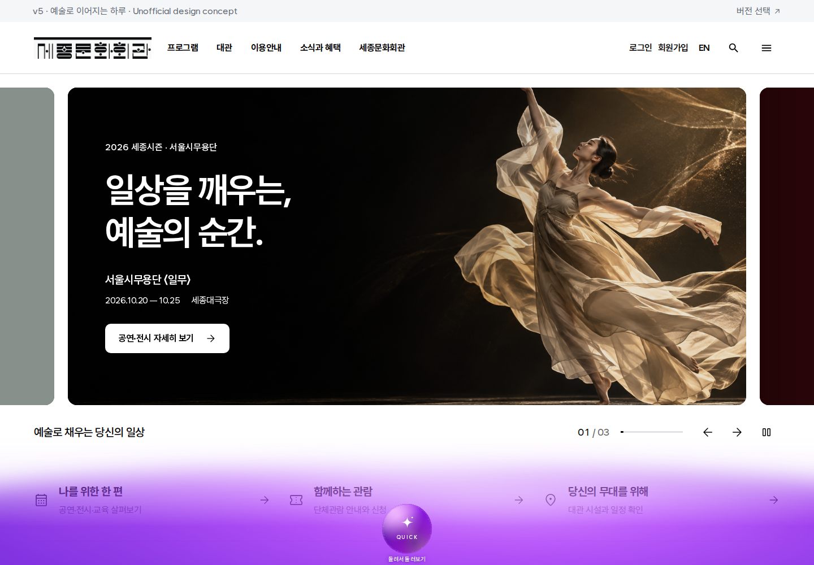
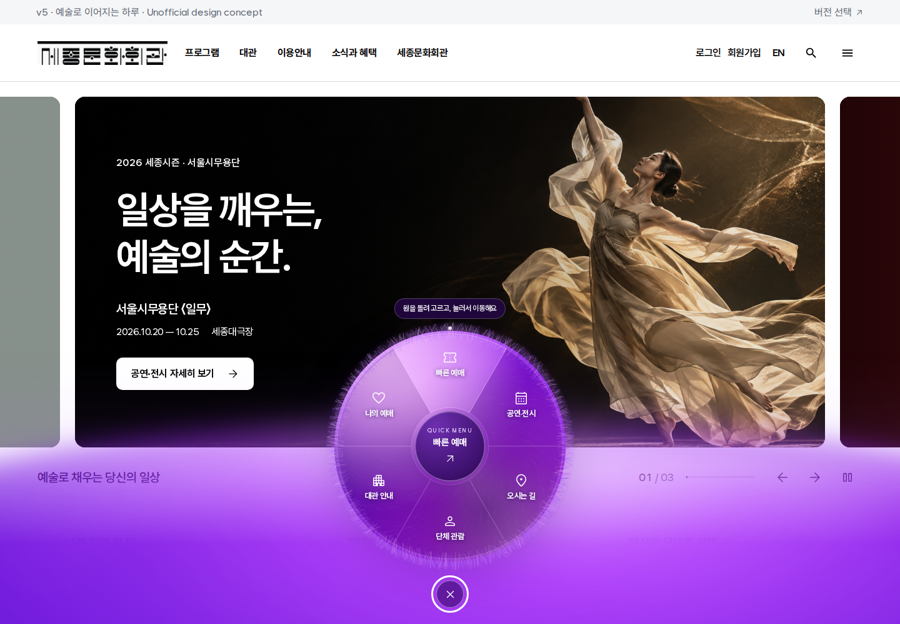
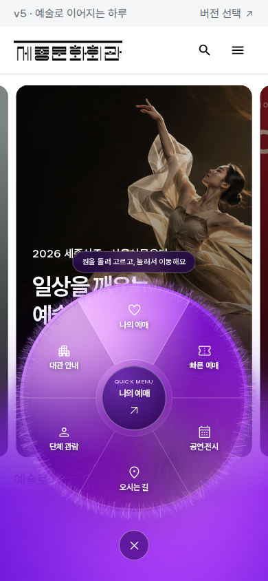

# v5 VioletQuickMenu 검증 기록

## 구현

히어로를 보는 동안 화면 아래에 움직이는 보라색 그라데이션과 작은 원이 나타납니다. 마우스를 올리거나 원을 탭하면 털 질감의 원형 퀵메뉴가 펼쳐집니다. 여섯 영역을 직접 돌리면 60도 간격으로 정렬되고, 각 링크 또는 중앙의 선택 항목으로 이동할 수 있습니다.

[컴포넌트 사용법 및 공개 API](../../v5/components/README.md)와 [원본 Figma 시안](https://www.figma.com/design/EufUvqqxgphtoLRX6bcdV6/Untitled?node-id=1-6)을 참고하세요.

## 검증 결과

2026-10-19, Chromium 151.0.7922.34에서 실제 정적 배포 파일을 제공하는 `/v5/` 경로로 확인했습니다.

| 검증 | 결과 |
| --- | --- |
| TypeScript 검사 | 통과 |
| Next.js 배포 빌드 및 기존 정적 파일 동기화 | 통과, 156개 페이지 생성 |
| 브라우저 동작 검증 | 25/25 통과 |
| 컴포넌트 및 기타 브라우저 오류 | 0건 |
| 독립 코드 리뷰 | 발견된 호버 재진입 문제 수정 후 통과 |

브라우저 검증은 기본 상태, 호버 진입과 재진입, 열기 전 잠깐 스친 후 재진입, 마우스 및 실제 터치 이벤트로 회전, 각도 경계 통과와 60도 정렬, 드래그 후 잘못된 이동 방지, 여섯 링크의 실제 이동, 중앙 예매 버튼의 스크롤과 제목 포커스, 키보드 선택과 Escape 포커스 복귀, 히어로 표시 범위, 모션 줄이기를 포함합니다.

레이아웃은 320·390·768·1024·1440px 너비와 844×390px 가로 화면에서 확인했습니다. 메뉴와 중앙 버튼이 겹치지 않고 화면 안에 있으며, 가로 스크롤이 추가되지 않습니다. 터치 회전 검증에는 390×844px 화면을 사용했습니다.

[전체 브라우저 결과](browser-results.json)에는 각 검증의 관측값과 당시 생성된 스크린샷 목록이 있습니다. 아래에는 대표 화면 세 장을 보관했습니다. 테스트 재실행 시 모든 캡처가 다시 생성됩니다.

## 대표 화면

### PC 기본 상태

### PC 펼침 상태

### 모바일에서 회전한 상태

