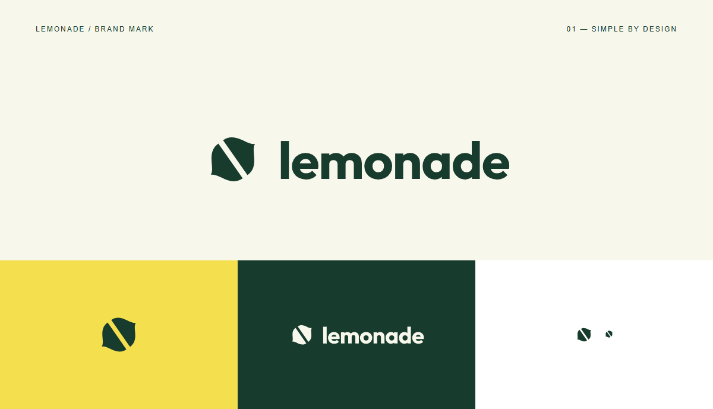

# lemonade

A simple two-part lemon silhouette and a lowercase wordmark, authored as SVG and displayed without external image or font requests. The Korean brand name is **레모네이드**.

| File | Use |
| --- | --- |
| [logo.svg](logo.svg) | Wordmark for light backgrounds; transparent canvas |
| [logo-light.svg](logo-light.svg) | Wordmark for dark backgrounds; transparent canvas |
| [mark.svg](mark.svg) | Standalone mark; transparent canvas |
| [icon.svg](icon.svg) · [icon.png](icon.png) | Yellow tile icon; 400×400 PNG |

The colors are forest green `#173B2C`, lemon yellow `#F4DF4E` and a light background `#F8F7EC`. The mark's silhouette and gap were inspected at 16px and 32px. Allow clear space around the wordmark of approximately one quarter of the mark's width or more.

The lettering uses outlined Outfit Bold from the preserved bundle and needs no font installation. Keep the [Outfit copyright notice and OFL](Outfit-OFL.txt) with it. This is lemonade's logo; sites created with the skill use their customer's own brand.
