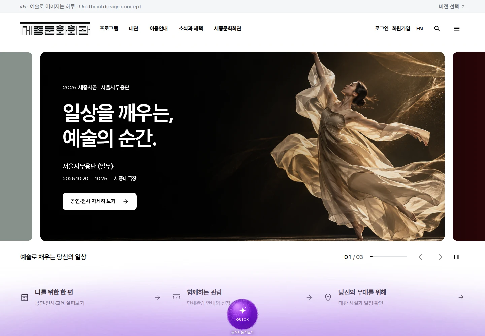
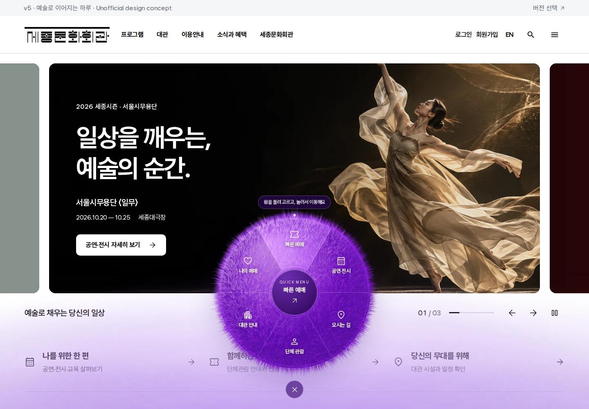

# Violet motion and homepage anchors — 2026-10-20

두 브랜치를 합친 프로덕션 출력의 검증 자료다. 자세한 구현·검사 범위와 병합 순서는 [수행 기록](../../violet-quick-menu-verification.md)에 있다.

| 검사 | 통과 | 기록 |
| --- | --- | --- |
| 실제 털 물리 | 5/5 | [physics-results.txt](physics-results.txt) |
| 고정 뿌리·그리기 예산·페이드·터치 | 5/5 | [smoke-results.json](smoke-results.json) |
| 홈 퀵메뉴 전체 | 25/25 | [home-results.json](home-results.json) |
| 갤러리와 입력 취소 | 11/11 | [gallery-results.json](gallery-results.json) |
| 앵커·이력·SVG·반응형 푸터 | 6/6 | [home-anchor-results.json](home-anchor-results.json) |

총 52개 통과. 모든 브라우저 검사에서 페이지·콘솔 오류 0개였으며, HTTP 오류를 수집한 스모크·앵커 검사에서도 0개였다. 빌드·타입 검사와 156/156 정적 페이지 생성을 통과했고, 내보낸 406개 파일 모두 배포 사본과 바이트가 같았다. 환경, 소스 해시, 로고의 네 사본과 출력 검증은 [build-summary.json](build-summary.json)에 있다.

## 화면





[390px 모바일 메뉴](mobile390-open.webp) · [PC 푸터](footer1440.webp) · [390px 푸터](footer390.webp) · [320px 푸터](footer320.webp)

[털 움직임과 마우스 회전 캡처 영상](fur-motion.mp4)은 실제 화면의 대기 → 표면 이동 → 회전 → 복귀 순서를 기록했다. 캡처 프레임 간격을 유지한 시연 자료이며 성능 측정용 영상은 아니다. 푸터 캡처의 테두리는 `#footer-citybrand`로 직접 진입한 링크의 키보드 포커스 표시다.

## 측정과 재현

Canvas 표본에서 504개 뿌리의 좌표가 프레임마다 같았다. 프레임당 캐시 합성 2회, 곡선 1,008회, 채우기 10회, 개별 스트로크와 새 그라데이션 0회였다. 이는 짧은 경로·작업량 검사이며 장시간 기기 성능 벤치마크는 아니다. [desktop-fade.json](desktop-fade.json)은 양방향 전환의 실제 중간 프레임, 적용 투명도와 전환 종료 상태를 보존한다.

스모크의 첫 고정시간 관찰은 전환이 끝나기 전에 종료되었다. 포인터와 Canvas 계측을 검사별로 분리하고 실제 끝점을 기다리도록 검사만 보완한 뒤, 동일한 빌드에서 통과한 최종 결과를 저장했다. 제품의 180ms 전환과 정확한 0/1 끝점 검사는 유지했다.

각 JSON의 스크린샷 목록은 해당 실행의 원본 PNG 이름/경로다. 이 폴더에는 위에 연결한 대표 WebP 화면을 보존했다. 모바일은 Chromium 151.0.7922.34의 화면·터치 에뮬레이션으로 확인했다.

`v5/`에서 실행 중인 정적 서버를 대상으로 재현한다. 별도의 Chromium을 쓰면 `CHROMIUM_PATH`를 지정한다.

```bash
npm run test:orb:motion
SEJONG_TEST_URL=http://127.0.0.1:8765/v5/ npm run test:orb:smoke
SEJONG_TEST_URL=http://127.0.0.1:8765/v5/ npm run test:orb
SEJONG_TEST_URL=http://127.0.0.1:8765/v5/ npm run test:orb:gallery
SEJONG_TEST_URL=http://127.0.0.1:8765/v5/ npm run test:home:anchors
```
