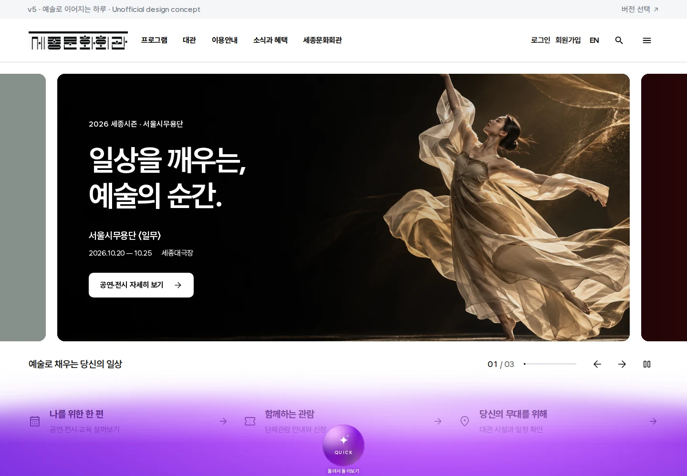
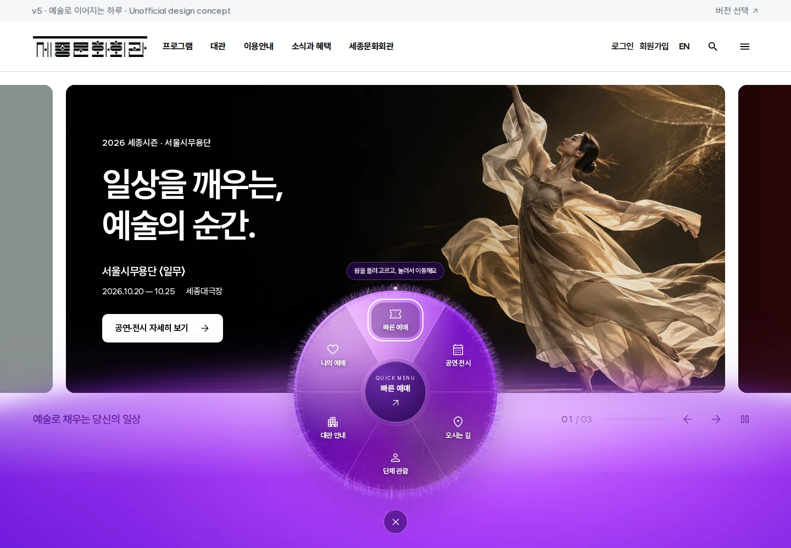

# 보라빛 퀵메뉴 수행·검증 기록

최근 통합 검증일: **2026-10-20**. 고정된 뿌리의 미세한 털 움직임, 보라색 빛, 메인 앵커와 서울 도시브랜드 배치를 함께 확인했다. 아래의 초기 털·페이드 및 10월 19일 기록은 이전 실행 이력으로 보존한다.

## 2026-10-20 털 물리·앵커·도시브랜드 후속 통합

촘촘한 두 속털 비트맵의 위치를 고정하고, 짧은 털 뭉치의 끝만 감쇠하는 스프링으로 움직이도록 바꿨다. 열린 원과 닫힌 원에서 매우 작은 대기 움직임을 유지하며, 포인터 속도와 터치 회전 방향에 부드럽게 반응한다. 내부와 하단의 보라색은 서로 다른 위상으로 움직이는 낮은 투명도의 방사형 색층을 사용한다. 현재의 작업량과 수명 관리는 [컴포넌트 가이드](components/violet-quick-menu.md)에 기록했다.

메인의 고정 영역·조작·공연·공지·날짜에는 안정된 ID를 추가했다. `HomeAnchorNavigation`이 직접 진입, 해시 변경과 뒤로/앞으로 가기에서 필요한 슬라이드·필터·달력을 먼저 펼치고, 실제 헤더 높이 아래로 스크롤한 뒤 제목 또는 조작에 포커스를 둔다. 기존 ID는 유지하며, 복제 슬라이드에는 ID와 탭 정지점을 만들지 않는다. 전체 주소는 [메인 앵커 목록](home-anchors.md)에 있다.

업로드된 `assets/logos/seoulmysoul-citybrand.svg`를 원본 그대로 공개 자산에 반영했다. [공식 세종문화회관 홈페이지](https://www.sejongpac.or.kr/)의 하단 구조를 참고하여 전화문의 아래, 패밀리 사이트 위에 배치했다. 최대 너비는 227px이고 작은 화면에서는 열 너비에 맞춰 줄어든다. 업로드 원본·public·정적 내보내기·배포 사본의 바이트가 모두 같다.

### 통합 출력으로 수행한 검사

두 브랜치의 소스를 합친 상태에서 프로덕션 빌드를 한 번 실행했다. 타입 검사와 **156/156 정적 페이지 생성**이 성공했고, `out/`의 **406개 파일 전부**가 배포용 `v5/` 사본과 바이트 단위로 일치했다. 새 출력에는 개발용 번들이나 hot update 파일이 없었다. [빌드·정적 출력 검증 JSON](evidence/violet-motion-anchors/build-summary.json)에 빌드 ID, 소스 해시와 환경을 기록했다.

| 검사 | 결과 | 근거 |
| --- | --- | --- |
| 실제 털 물리 모듈 | 5/5 통과 | [물리 검사 결과](evidence/violet-motion-anchors/physics-results.txt) |
| 털 그리기·양방향 페이드·터치 핵심 검사 | 5/5 통과 | [스모크 결과](evidence/violet-motion-anchors/smoke-results.json) |
| 기존 홈 퀵메뉴 전체 동작 | 25/25 통과 | [홈 결과](evidence/violet-motion-anchors/home-results.json) |
| 인라인 갤러리·입력 취소 | 11/11 통과 | [갤러리 결과](evidence/violet-motion-anchors/gallery-results.json) |
| 메인 앵커·이력·로고 | 6/6 통과 | [앵커 결과](evidence/violet-motion-anchors/home-anchor-results.json) |

총 **52개 검사**를 통과했다. 브라우저 페이지·콘솔 오류는 각 검사에서 0개였고, HTTP 오류를 수집한 스모크·앵커 검사에서도 0개였다. Chromium 151.0.7922.34에서 정적 출력 `http://127.0.0.1:8765/v5/`를 검사했다.

- 650ms 그리기 표본에서 9개 프레임을 관찰했다. 프레임당 캐시 이미지 2회, 고정된 뿌리 504개, 곡선 1,008회, 색상별 채우기 10회였으며 스트로크와 새 그라데이션 생성은 0회였다. 곡선은 작은 움직이는 털층에만 사용한다.
- 양방향 스크롤의 중간 투명도는 0.4975였고, 사라짐은 정확히 0, 복귀는 정확히 1이었다. CSS 페이드 시간 0.18s와 실제 중간 전환 프레임을 확인했다. 완전히 숨은 원은 `inert` 상태이며 포인터와 포커스를 점유하지 않는다. [전환 프레임 원시 기록](evidence/violet-motion-anchors/desktop-fade.json)
- 실제 CDP 터치 회전·정렬·우발적 이동 방지, 여섯 목적지와 예매 제목 포커스, 창 포커스 상실·크기 변경 중 입력 취소가 모두 통과했다. 동작 줄이기 설정에서는 반복 털 그리기와 메뉴 애니메이션이 0회였다.
- 홈은 320·390·768·1024·1440px와 844×390 가로 화면, 갤러리는 320·390·768·1024px를 검사했다. 서울 로고는 1440·390·320px에서 원본 비율, 전화/로고/선택창의 순서, 가로 넘침 0px를 확인했다.
- 직접 주소와 해시 변경 모두에서 비활성 히어로, 첫 네 카드 밖의 공연·공지, 다른 달의 날짜와 방문 미리보기를 확인했다. 중복 ID, 뒤로/앞으로 가기, 잘못된 날짜·깨진 URL 인코딩도 검사했다.

짧은 Canvas 관찰은 그리기 경로와 작업량 검증이다. 실제 모든 기기의 프레임 속도를 보장하는 성능 측정은 아니며, 모바일은 Chromium의 화면·터치 에뮬레이션으로 확인했다.

### 검사 안정화와 화면 기록

첫 스모크 실행에서는 고정 350ms 관찰이 복귀 전환의 끝부분인 0.995215에서 종료되었다. 저장된 프레임은 정지한 페이드가 아닌 늦게 시작한 정상 전환을 보였다. 검사 중 포인터를 열기 버튼에서 떼고 Canvas 계측을 필요한 구간에만 켜며, 실제 적용 투명도와 일치하고 전환이 끝난 두 프레임까지 기다리도록 검사만 보완했다. 최대 대기는 2초로 제한하고, 정확한 0/1 끝점·중간 프레임·제품의 180ms CSS 시간 검사는 유지했다. 같은 프로덕션 출력의 스모크 5개를 재실행하여 모두 통과했으며, 제품 코드나 빌드를 바꾸지 않았다.

[PC 대기 화면](evidence/violet-motion-anchors/desktop-resting.webp) · [PC 펼침 화면](evidence/violet-motion-anchors/desktop-open.webp) · [390px 모바일](evidence/violet-motion-anchors/mobile390-open.webp) · [PC 푸터](evidence/violet-motion-anchors/footer1440.webp) · [390px 푸터](evidence/violet-motion-anchors/footer390.webp) · [320px 푸터](evidence/violet-motion-anchors/footer320.webp) · [털·회전 캡처 영상](evidence/violet-motion-anchors/fur-motion.mp4)

### 브랜치 구성

기준 `main`은 업로드 로고가 포함된 `0f41144a2fb5949ca696b00245d6f64770195dfd`이다. 기존 퍼 하위 브랜치와 새 형제 브랜치가 각각 최신 main을 no-ff로 반영했다. 퍼 하위 브랜치를 상위 브랜치에 먼저 no-ff 병합한 뒤, 앵커 형제 브랜치를 별도의 no-ff 병합으로 통합했다. 이 두 번째 통합에 검증된 정적 출력·검사 보완·문서와 증거 파일을 함께 담고, 상위 브랜치를 main에 다시 no-ff 병합하는 흐름이다.

| 작업 | 브랜치 | 구현 커밋 |
| --- | --- | --- |
| 기존 퍼 하위 브랜치 계속 사용 | `chatgpt/v5-violet-quick-menu-fur-fade` | [75c55cf](https://github.com/hslcrb/renewsejongpac/commit/75c55cf5e17a13de5b0a6122600ff948d5ea8c23) |
| 새 앵커·도시브랜드 형제 브랜치 | `chatgpt/v5-home-anchors-citybrand` | [0e74d94](https://github.com/hslcrb/renewsejongpac/commit/0e74d942895639e5ca3ec581076b2ed357919a27) |
| 퍼 작업의 첫 no-ff 통합 | `chatgpt/v5-violet-quick-menu` | [ab4abc5](https://github.com/hslcrb/renewsejongpac/commit/ab4abc5fc7281593f4c1a82c2c84cc3ceef093bf) |

최종 통합 이력은 [상위 브랜치 커밋](https://github.com/hslcrb/renewsejongpac/commits/chatgpt/v5-violet-quick-menu)과 [main 커밋](https://github.com/hslcrb/renewsejongpac/commits/main)에서 확인할 수 있다. 아래의 `5116ba7`·`d76b341`·`2f3c6fa`는 이전 털·페이드 작업 이력이다.

## 2026-10-20 초기 털 질감·스크롤 페이드 개선

### 반영 내용과 컴포넌트 등록

히어로 상단이 헤더 기준선을 지나면 보라색 배경과 원형 메뉴가 120–180px의 짧은 스크롤 구간에 걸쳐 함께 흐려지고, 역방향에서는 같은 구간에서 다시 나타난다. 180ms `ease-out` 전환으로 입력을 부드럽게 잇는다. 히어로가 아직 화면에 남아 있어도 페이드는 완료되며, 완전히 투명해지면 `inert`, `aria-hidden`과 포인터 차단으로 메뉴가 입력을 가로채지 않게 한다. 문서 흐름 안의 `inline` 예시에는 이 페이드를 적용하지 않는다.

당시 털은 명암이 있는 속털과 끝이 가늘어지는 짧은 섬유를 표면 전체에 겹쳐 표현했다. 최대 16,200개의 섬유를 두 개의 비트맵으로 미리 그리고 재사용하며, 반복 프레임은 이미지 두 장만 합성했다. 데스크톱은 최대 24fps·DPR 1.5, 터치 또는 논리 코어가 4개 이하인 기기는 최대 20fps·DPR 1.25로 제한했다. 닫힌 원은 정적인 질감을 사용하고 화면 밖·숨겨진 탭에서는 반복 그리기를 멈췄다. 털 위의 보라색 조명은 CSS로 천천히 흘렀다. 이후 고정된 뿌리의 움직임을 추가한 현재 소스는 이 합성 전용 경로와 다르다.

기존 여섯 목적지, [공개 내보내기](../components/index.ts), [디자인 가이드 갤러리](../app/design-rules/page.tsx)의 등록을 유지했다. 현재 `main`에 있던 갤러리와 키보드·입력 취소 수정도 함께 보존했다. 재사용 위치는 `/v5/design-rules/#violet-quick-menu`이며, 상세 API와 수명 관리는 [컴포넌트 가이드](components/violet-quick-menu.md)에 있다.

### 기능 수정 당시 수행한 필수 검증

프로덕션 빌드 한 번에서 타입 검사와 **156/156 정적 페이지 생성**을 통과했다. 이후 `http://127.0.0.1:8765/v5/`의 정적 출력에서 Chromium **151.0.7922.34**로 핵심 검사 **5/5**를 통과했다. 아래 결과는 [저장된 스모크 보고서](evidence/violet-fur-fade/smoke-results.json)에 근거한다.

| 검사 | 확인한 결과 |
| --- | --- |
| 털 캐시 합성 | 650ms 표본의 9개 그리기 프레임에서 프레임당 `drawImage` 최대 2회, 곡선·스트로크·그라데이션 생성 0회 |
| PC 양방향 스크롤 페이드와 입력 차단 | 양방향 중간 투명도 0.4975, 완전히 숨을 때 0, 상단 복귀 시 1. 숨은 메뉴는 포인터나 포커스를 점유하지 않음 |
| 동작 줄이기 | 관찰 구간의 털 그리기 0회, 실행 중인 메뉴 애니메이션 0개, 루트 전환 시간 0s |
| 390px 모바일 터치 회전과 빠른 예매 | 실제 CDP 터치로 0° → 180° 회전·정렬, 드래그 중 우발적 이동 없음, 예매 링크로 `quick-booking-heading`에 포커스 이동 |
| 모바일 스크롤 복귀와 반응형 | 복귀 후 투명도 1, 가로 넘침 0px |

콘솔·페이지 오류와 HTTP 400 이상 응답은 모두 0개였다. PC와 390px 모바일 캡처에서도 원형 메뉴의 배치와 여섯 링크의 가독성을 확인했다. 캐시 측정은 텍스처 준비 이후의 짧은 관찰이며, 모든 기기의 실측 프레임 속도를 보장하는 벤치마크는 아니다. 아래의 10월 19일 전체 검사 36개는 이전 실행 기록으로 보존하며 이번에 재실행하지 않았다.

[PC 구현 화면](evidence/violet-fur-fade/desktop.webp) · [390px 모바일 구현 화면](evidence/violet-fur-fade/mobile390.webp)

핵심 검사 스크립트는 [`tests/violet-quick-menu-smoke.cjs`](../tests/violet-quick-menu-smoke.cjs)에 등록했다. 실행 중인 서버를 대상으로 `SEJONG_TEST_URL=http://127.0.0.1:8765/v5/ npm run test:orb:smoke`로 재현할 수 있다.

### 커밋·병합·푸시 완료 기록

기존 상위 브랜치에서 하위 브랜치를 만들고 최신 `main`의 `4b7affb`를 반영한 뒤 구현을 완료했다. 두 대상 브랜치에서 각각 `--no-ff` 병합을 수행했으며, 소스·컴포넌트 문서·검증 자료·정적 배포 파일을 함께 푸시했다.

| 단계 | 브랜치 | 커밋 |
| --- | --- | --- |
| 구현 및 최신 main 반영 | `chatgpt/v5-violet-quick-menu-fur-fade` | [5116ba7](https://github.com/hslcrb/renewsejongpac/commit/5116ba7476f4096f3f17dbe6202d1e853dc4937e) |
| 하위 브랜치를 `--no-ff` 병합 | `chatgpt/v5-violet-quick-menu` | [d76b341](https://github.com/hslcrb/renewsejongpac/commit/d76b341218d51b1fec7766dd9a5044511b48e9d6) |
| 상위 브랜치를 `--no-ff` 병합 | `main` | [2f3c6fa](https://github.com/hslcrb/renewsejongpac/commit/2f3c6fa7075da4fb10978bc76d6f95cd3739efdc) |

세 원격 브랜치의 SHA와 두 병합 커밋의 부모를 확인했다. 세 커밋의 최종 트리는 `e3c1eaf1f956987c00be2c4e8dcd0c76799e9265`로 같으며, 기능 작업 종료 시 미커밋 변경은 없었다. 2026-10-20 문서 보완 시 기능 병합 커밋 `2f3c6fa`의 [Vercel 상태](https://vercel.com/hslcrbs-projects/renewsejongpac/4yJe5KPK2LAgJ4V7iNLaDR8hxUum)가 **success**임을 확인했다.

이번 후속 문서 보완은 저장된 검사 결과와 완료된 Git 이력을 정리한 작업이다. 사용자의 요청에 따라 별도 기능 브랜치 없이 `main`에 직접 반영하며, 빌드와 브라우저 테스트를 추가 실행하지 않았다.

## 2026-10-19 통합 검증 결과

당시 검증 기준은 원격 `main`의 `fbe1dc0f945419bfdf9337d83ac5a61d124c9918`이었다. 여섯 메뉴와 Figma 배치를 보존하고, 재사용 갤러리·실행 환경·입력 처리를 보완했다. 이 절 이후의 환경·결과·화면은 해당 날짜의 기록이다.

| 항목 | 결과 | 근거 |
| --- | --- | --- |
| 홈 브라우저 검사 | 25/25 통과 | [홈 결과 JSON](evidence/violet-quick-menu/results.json) |
| 갤러리 및 입력 취소 검사 | 11/11 통과 | [갤러리 결과 JSON](evidence/violet-quick-menu/gallery-results.json) |
| 브라우저 페이지·콘솔 오류 | 두 검사 모두 0개 | 위 두 보고서의 `menuErrors`, `unrelatedErrors` |
| 프로덕션 빌드·타입 검사 | 성공, 정적 페이지 156/156 생성 | [빌드 요약과 소스 해시](evidence/violet-quick-menu/build-summary.json) |
| 정적 출력 동기화 | 기존 변경 파일 308개와 신규 번들 19개가 `out/`과 바이트 단위로 일치 | 같은 빌드 요약 |
| 개발용 출력 혼입 | 개발 디렉터리·hot update 파일 0개 | `.next/static`, `out/_next/static`, 배포용 `_next/static` 검사 |

검사는 `http://127.0.0.1:3011/v5/`에서 제공한 프로덕션 정적 출력으로 실행했다. Node.js 24.19.0, npm 11.9.0, Next.js 14.2.35, Playwright 1.62.1, Google Chrome for Testing 155.0.8059.84를 사용했다. 빌드의 타입 검사는 통과했고, ESLint는 기존 Next.js 설정에 따라 생략되었다.

## 반영한 동작과 재사용

[Figma 노드 1:6](https://www.figma.com/design/EufUvqqxgphtoLRX6bcdV6/Untitled?node-id=1-6)의 캡처 위 그림을 직접 확인했다. 화면 하단에 넓게 번지는 보라색 빛과 중앙의 작은 원을 배치 기준으로 삼았다. 펼친 메뉴, 퍼의 세부 질감, 회전 및 모바일 동작은 요청의 설명을 바탕으로 구현한 부분이다.

기존 여섯 목적지와 공개 내보내기를 유지하며 `placement="inline"`을 추가했다. 기본 `hero` 배치는 히어로를 보는 동안 화면 하단에 나타나고, `inline` 배치는 부모 너비에 맞춰 문서 안에서 재사용된다. 디자인 규칙 페이지의 **보라빛 퀵메뉴** 영역에서 같은 컴포넌트를 조작할 수 있다. 갤러리의 빠른 예매는 홈의 실제 예매 섹션에 연결한다.

메뉴는 마우스 호버·클릭, 터치, 키보드로 연다. 원을 돌리면 60도 간격으로 정렬하고, 링크를 누를 때 목적지로 이동한다. 화면 밖에서는 장식의 반복 움직임을 멈추고, 동작 줄이기 설정에서는 자동 모션과 관성을 끈다. 회전 중 창의 포커스를 잃거나 화면 크기가 바뀌면 포인터 캡처를 해제한다.

사용법, 여섯 목적지와 공개 API는 [컴포넌트 가이드](components/violet-quick-menu.md)와 [컴포넌트 README](../components/README.md)에 기록했다. 실행 안내를 현재 Next.js 구조에 맞게 고쳤고, `prebuild` 정리 및 `postbuild` 검사로 개발용 번들이 정적 출력에 섞이지 않게 했다. 홈 방문 안내 이미지 두 곳의 `/v5` 자산 경로도 바로잡았다.

## 확인한 범위

- 홈 너비 320·390·768·1024·1440px와 844×390px 가로 화면에서 원, 여섯 링크, 가운데 버튼의 화면 내 배치와 겹침을 확인했다.
- 갤러리 너비 320·390·768·1024px에서 부모 영역 안의 배치, 44px 이상의 메뉴 목표 크기, 페이지 가로 넘침 방지를 확인했다.
- 마우스·실제 CDP 터치 이벤트로 각도 경계를 지나는 회전, 연속성, 정렬, 드래그 뒤 우발적 이동 방지와 여섯 링크의 실제 도착 경로를 확인했다.
- 첫 키보드 포커스, 방향키·Home·End·Tab·Enter·Space·Escape, 갤러리에서 홈 예매로 이동, 화면 밖 정지와 재진입을 확인했다.
- 창 blur 이벤트를 발생시킨 검사와 실제 브라우저 뷰포트 크기 변경으로 진행 중인 드래그가 취소되고 다음 드래그가 가능한지 확인했다.

모바일 검사는 Chromium의 터치 및 화면 에뮬레이션 기준이다. 실제 iOS Safari 기기, 스크린 리더 사용성 평가, 장시간 기기별 성능 측정은 이 기록에 포함하지 않는다.

## 검사 중 확인하고 수정한 문제

키보드로 열 때 React의 열림 상태가 반영된 뒤에도 CSS 표시 전환의 첫 시점에서는 링크가 `visibility: hidden`으로 계산되어 포커스가 거부되었다. 열린 패널에서는 transform과 opacity만 전환하도록 조정해 첫 메뉴가 즉시 포커스를 받을 수 있게 했다. 펼침 모션과 닫힘의 표시 전환은 유지했다.

터치 자동 검사에서는 펼침 전환의 시간이 아직 0인 100.4px 원을 안정된 크기로 판단해, 최종 332px 원과 다른 좌표로 입력하는 문제가 재현되었다. 검사 도우미가 상위 요소의 진행 중인 CSS 전환이 끝났는지 확인하고, 시작점이 실제 메뉴 링크인지 확인하도록 수정했다. 회전량·정렬·이동 방지 검사는 그대로 유지했다. 수정 후 진단 도구 없이 저장소의 원래 검사 스크립트 전체를 실행해 25개 모두 통과했다.

## 대표 화면

대기 상태의 하단 그라데이션:



펼친 원형 메뉴와 첫 메뉴의 키보드 포커스:



[모바일 홈 화면](evidence/violet-quick-menu/home-open-mobile.webp) · [모바일 컴포넌트 갤러리](evidence/violet-quick-menu/gallery-open-mobile.webp)

## 재현

저장소의 `v5/`에서 개발 서버를 종료한 후 실행한다.

```bash
npm ci
npm run build
```

저장소 루트에서 정적 서버를 실행한다.

```bash
python3 -m http.server 3011 --bind 127.0.0.1
```

별도 터미널의 `v5/`에서 검사한다. Playwright용 Chromium 설치가 필요하면 `npx playwright install chromium`을 먼저 실행한다. 기존 Chromium을 사용할 때는 `CHROMIUM_PATH`에 실행 파일의 절대 경로를 지정한다.

```bash
SEJONG_TEST_URL=http://127.0.0.1:3011/v5/ npm run test:orb
SEJONG_TEST_URL=http://127.0.0.1:3011/v5/ npm run test:orb:gallery
```

보고서와 PNG 캡처의 기본 위치는 무시되는 `.lemonade/violet-quick-menu/`이며, `SEJONG_VIOLET_REPORT_DIR`로 바꿀 수 있다. 기존 여섯 메뉴 구현의 이전 검증 기록은 [별도 기록](../../docs/v5-violet-quick-menu/README.md)에 보존되어 있다.
